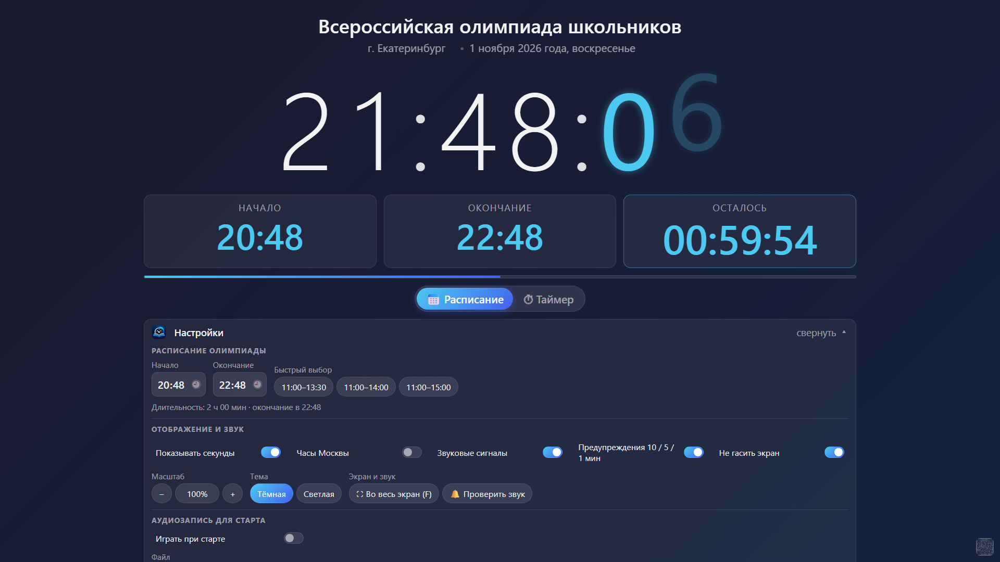
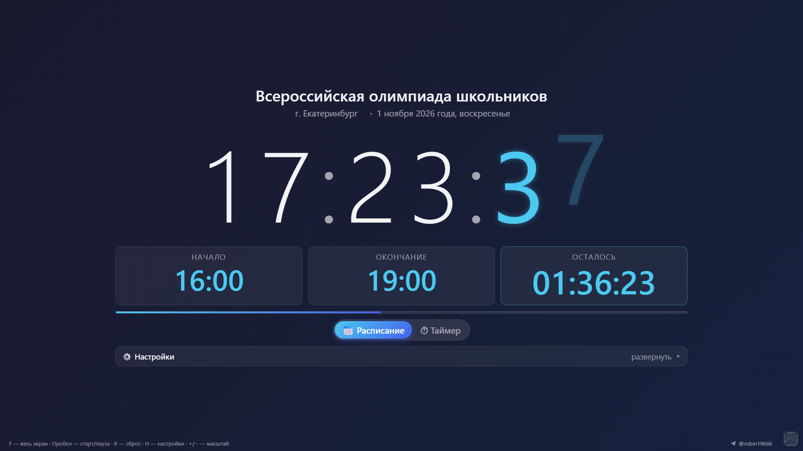
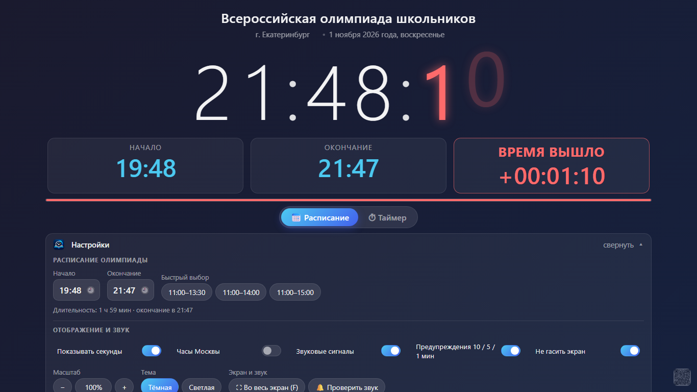
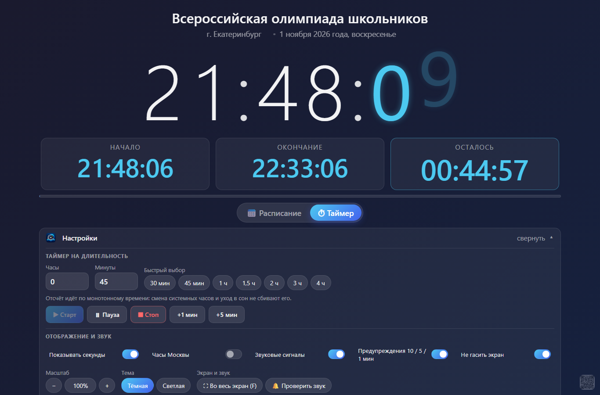
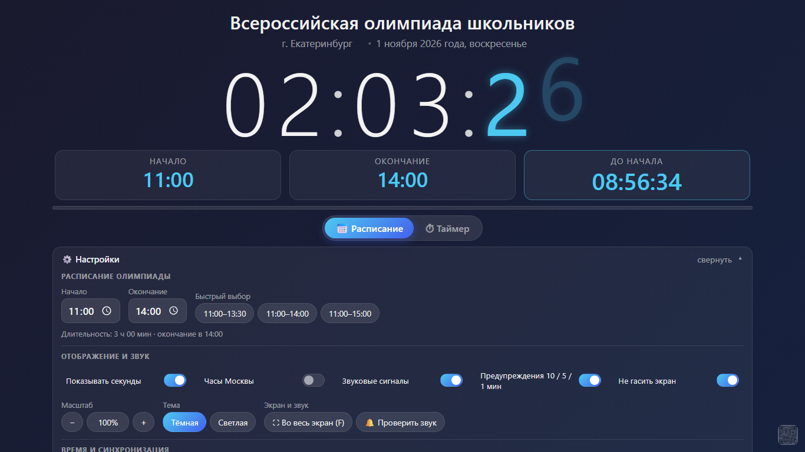
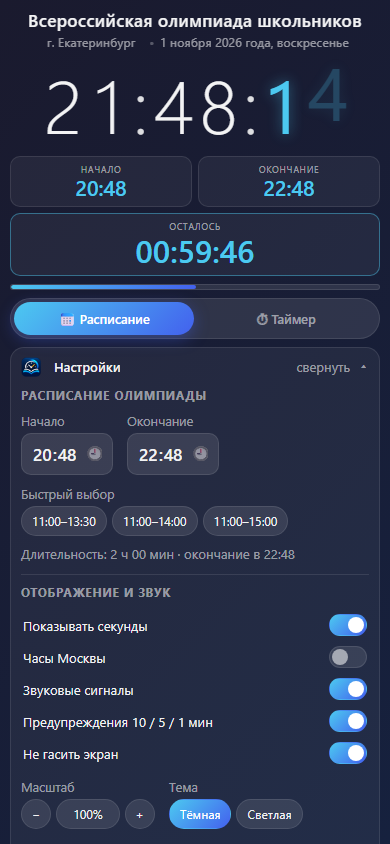

# Часы и таймер для олимпиад

Один HTML-файл: часы, расписание и обратный отсчёт. Работает **полностью без интернета**,
без установки и без внешних зависимостей — открывается двойным щелчком в любом браузере.

[**Открыть в браузере**](https://robin19666.github.io/olymp-clock/) ·
[**Скачать файл**](https://github.com/RoBiN19666/olymp-clock/raw/main/index.html) ·
[**Скачать APK**](https://github.com/RoBiN19666/olymp-clock/releases/latest)



---

## Зачем

На олимпиаде нужны большие часы, которые видно с последнего ряда, и понятный отсчёт до конца
работы. Готовые онлайн-таймеры требуют интернета, а обычные часы Windows не показывают,
сколько осталось. Здесь всё в одном файле: скопировал на флешку — работает в любом кабинете.

## Два режима

**📅 Расписание** — фиксированное начало и окончание. Время считается по часовому поясу
Екатеринбурга (UTC+5) независимо от настроек компьютера. Состояние — «до начала» / «идёт» /
«завершено» — пересчитывается каждую секунду, страницу можно закрыть и открыть снова.

**⏱ Таймер** — обратный отсчёт от заданной длительности: старт, пауза, продолжение, стоп и
кнопки «+1 / +5 мин». Идущий таймер сохраняется: если страницу случайно закрыли или
компьютер перезагрузился, отсчёт продолжится с того же места.

Когда время выходит, карточка «Осталось» превращается в «ВРЕМЯ ВЫШЛО», а под ней начинает
идти счётчик **в плюс** — видно, сколько уже прошло после окончания.

| | |
|---|---|
|  |  |

| | | |
|---|---|---|
|  |  |  |

## Возможности

- **Полный экран и масштаб** 60–200 %: на проекторе видно с любого ряда.
- **Сворачиваемые настройки**: в рабочем режиме часы центрируются и становятся крупнее.
- **Звук без файлов** (синтез в браузере): предупреждения за 10, 5 и 1 минуту, тиканье
  последних секунд, финальная трель.
- **Тёмная и светлая тема** — светлая для светлой аудитории.
- **Часовой пояс** выбирается: 11 поясов России плюс ближайшие соседи, плюс автоопределение
  по компьютеру. По умолчанию — Екатеринбург (UTC+5), как и раньше.
- **Часы Москвы** второй строкой, если в заданиях указано московское время.
- **Поправка часов** ±30 с: если часы компьютера врут, а интернета нет.
- **Аудиозапись к старту** — для аудирования по иностранным языкам: файл запускается сам
  в момент начала, без переключения окон.
- **Не гасить экран** (Wake Lock), обратный отсчёт в заголовке вкладки, защита от случайного
  закрытия страницы во время отсчёта.
- **Своё название и место** — клик по заголовку или по городу.
- **Запуск с параметрами в ссылке** — ярлык под конкретный предмет (см. ниже).

## Горячие клавиши

| Клавиша | Действие |
|---|---|
| `F` | во весь экран |
| `Пробел` | старт / пауза (режим «Таймер») |
| `R` | сброс таймера |
| `H` | свернуть / развернуть настройки |
| `+` / `−` | масштаб |
| `0` | масштаб 100 % |

## Запуск с готовыми настройками

```
index.html?mode=schedule&start=11:00&end=14:00&title=Математика
index.html?mode=timer&dur=90&auto=1&title=Физика
```

| Параметр | Значение |
|---|---|
| `mode` | `schedule` или `timer` |
| `start`, `end` | `11:00`, `14:00` (режим «Расписание») |
| `dur` | длительность таймера в минутах |
| `auto` | `1` — сразу запустить таймер |
| `title`, `location` | название олимпиады и площадка |
| `theme` | `dark` или `light` |
| `sec` | `1` / `0` — показывать секунды |
| `scale` | масштаб, 1 = 100 % |
| `tz` | `Europe/Moscow`, `Asia/Novosibirsk`, `auto` … |

В Windows параметры можно прописать в ярлыке:

```
msedge.exe --kiosk --app="file:///D:/Олимпиада/index.html?mode=schedule&start=11:00&end=14:00"
```

## Аудирование

Для иностранных языков: в панели есть раздел «Аудиозапись для старта». Выбираете файл
(mp3, wav, m4a, ogg) — он никуда не загружается и остаётся на компьютере, — включаете
«Играть при старте», и запись запускается сама:

Файл можно **просто перетащить на страницу** — работает на всё окно, целиться в кнопку
не нужно. При перетаскивании экран подсвечивается рамкой с подсказкой; не-аудио файлы
отклоняются.

- в режиме **«Расписание»** — в момент начала олимпиады;
- в режиме **«Таймер»** — вместе со стартом отсчёта.

Кнопки **▶ Играть / ⏸ Пауза**, **⏹ Стоп** (в начало), **⏪ 10** и **10 ⏩** — для репетиции
и подгонки. Полосу можно перетаскивать мышью: под ней видно, сколько прошло, сколько
всего и сколько осталось. Больше не нужно держать аудио отдельным окном и переключаться.

**Полоса-пульт над настройками.** Если «Играть при старте» выключена — запускать придётся
вручную, поэтому полоса появляется сразу после выбора файла: пауза, стоп и оставшееся
время под рукой, настройки открывать не надо. При включённом автозапуске она появляется
только когда запись уже играет. В обоих случаях после окончания записи полоса исчезает
и не занимает место на экране.

Одна оговорка: браузер не даёт запускать звук без единого клика по странице. Если это
случится, появится подсказка «Нажмите ▶ Играть» — хватит одного нажатия, дальше всё
работает. В APK такого ограничения нет.

Файл запоминается в хранилище браузера, но не во всех: при открытии через `file://` Chrome
иногда его не сохраняет — тогда после перезагрузки страницы нужно выбрать файл заново
(подсказка об этом есть под кнопками).

## Интернет

Интернет **не нужен**: часы, таймер и звук работают локально. Если сеть есть, время раз в
15 минут сверяется с сервером (с учётом задержки), а поправка сохраняется — при следующем
запуске без сети часы всё равно идут правильно. Источников пять, перебираются по порядку:
`timeapi.io` → `1.1.1.1` (Cloudflare) → `binance` → `bybit` → `gate.io`. Последний удачный
пробуется первым.

## Совместимость

| Браузер | Что будет |
|---|---|
| Chrome / Edge / Яндекс 105+ | всё как задумано |
| Chrome 84–104 | всё, кроме точной подгонки надписи «ВРЕМЯ ВЫШЛО» |
| Chrome 79–83 | пропадают отступы между блоками |
| Chrome 60–78 | фиксированные размеры шрифтов, страница читаемая и рабочая |

Адаптивные размеры (`clamp()`) вынесены в блок `@supports`: браузер, который их не понимает,
берёт простые значения из основных правил и не разваливается.

## Android-доски

На части интерактивных панелей нет приложения, связанного с `.html`, — файл просто нечем
открыть. Для них есть **готовый APK** в [релизах](https://github.com/RoBiN19666/olymp-clock/releases/latest):
та же страница внутри пакета, полный экран, экран не гаснет, кнопка «Назад» закрывает.

Скачать APK на доску → открыть файл → при запросе разрешить установку из неизвестных
источников. Размер — около 130 КБ, интернет не нужен.

Исходники обёртки — в папке [`apk/`](apk/README.md): обычный проект Android Studio, если
захочется собрать самому или поправить.

## Файлы

```
index.html          ← сами часы, всё в одном файле
apk/                ← Android-обёртка (WebView + assets/clock.html)
screenshots/        ← картинки для этого README
```

## Лицензия

[MIT](LICENSE) — можно использовать, копировать, изменять и распространять.

---

© 6RoBiN6 · Telegram: [@robin19666](https://t.me/robin19666)
